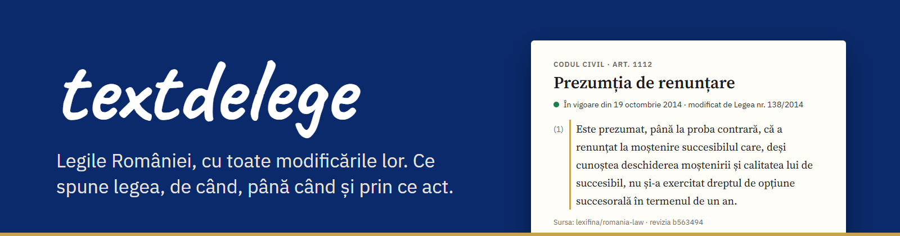
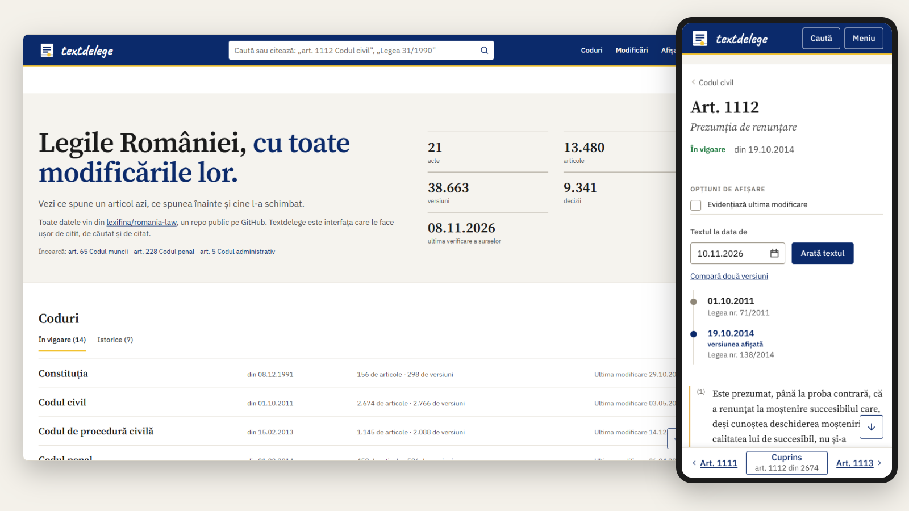

 

**Constituția și codurile României, articol cu articol, în toate versiunile lor.** 
**The Romanian Constitution and codes, article by article, in every version.**

 

**[textdelege.ro](https://textdelege.ro)** · **[Română](#română)** · **[English](#english)**

 

## Română

### Despre proiect

Textul unei legi pe care îl găsești pe internet este aproape mereu cel de azi. Din el nu afli de când se aplică și nici cum arăta înainte. Dacă ai nevoie de forma unui articol la o anumită dată, de exemplu ziua în care ai semnat un contract, trebuie să refaci singur modificările, una câte una.

Textdelege arată fiecare articol din Constituție și din cele 20 de coduri, actuale și abrogate, în toate versiunile lui:

- alegi o zi și citești textul care se aplica atunci;
- pui două versiuni una lângă alta și vezi, cuvânt cu cuvânt, ce s-a schimbat;
- afli ce act a scris fiecare alineat;
- vezi lângă articol deciziile Curții Constituționale și ale Înaltei Curți care îl privesc.

Textele vin din [lexifina/romania-law](https://github.com/lexifina/romania-law), un repo public în care fiecare articol este un fișier și fiecare modificare este un commit datat cu ziua intrării în vigoare. Textdelege nu adaugă text juridic propriu. Afișează aceste fișiere, spune din ce commit provine fiecare text și trimite la pagina oficială de pe legislatie.just.ro.

### Adrese

Orice pagină are o adresă stabilă, pe care o poți cita sau trimite mai departe.

| Adresă | Ce arată |
|---|---|
| `/codul-civil/art-1112` | articolul în forma de azi |
| `/codul-civil/art-1112/2019-01-01` | articolul în forma de la 1 ianuarie 2019 |
| `/codul-civil/art-1112/compara/2011-10-01..2014-10-19` | diferențele dintre două versiuni |
| `/codul-civil` · `/codul-civil/istoric` | actul întreg și istoricul modificărilor lui |
| `/codul-civil/2015-01-01` | actul întreg la o dată |
| `/legislatie/2020-01-01` | toate actele, cu starea fiecăruia la o dată |
| `/modificari` · `/modificari/codul-civil` | ultimele modificări, pe tot site-ul sau pe un act |
| `/abonare` · `/abonare/codul-civil` | abonarea la modificări dintr-un cititor de fluxuri |
| `/jurisprudenta/ccr/2016/405` | o decizie și articolele pe care le privește |
| `/lege/2011/71` | un act modificator și tot ce a schimbat |

În căutare poți scrie o trimitere așa cum apare într-un document, de exemplu `art. 1112 Codul civil`, `art. 52^1 C. pen.` sau `Legea 31/1990`, și ajungi direct la articol. Orice alt text se caută în legislația în vigoare.

Site-ul funcționează și fără JavaScript. Este gratuit, nu cere cont și nu urmărește vizitatorii.

### Cum funcționează

În fiecare zi, site-ul preia din sursă textele noi și modificările lor, le verifică și abia apoi le publică. Dacă verificarea găsește o nepotrivire, rămâne online varianta din ziua precedentă. Paginile sunt generate pe server, așa că se încarcă repede și funcționează în orice browser.

O versiune poartă data intrării în vigoare, nu data publicării în Monitorul Oficial.

Sursele designului și ce folosim pe site sunt descrise în [docs/design.md](docs/design.md).

### Limite

Textele consolidate de aici nu sunt oficiale. Singura formă autentică este cea publicată în Monitorul Oficial. Unele acte sunt marcate în sursă „amended, not consolidated”: modificările lor sunt cunoscute, dar textul poate să nu le cuprindă pe toate. Sursa nu păstrează titlurile capitolelor, așa că cuprinsul unui act este o listă de articole. Căutarea acoperă doar textul în vigoare.

### Contribuții

- **O greșeală în textul unei legi, o dată greșită sau o modificare lipsă:** deschide un issue în [repo-ul sursă](https://github.com/lexifina/romania-law/issues), unde sunt întreținute datele.
- **O problemă pe site sau o idee:** scrie-ne din pagina [Despre](https://textdelege.ro/despre#contact).

### Licență

Textele legilor și ale deciziilor nu sunt protejate de dreptul de autor (Legea nr. 8/1996, art. 9 lit. b). Organizarea datelor din repo-ul sursă este sub licența [CC0](https://github.com/lexifina/romania-law), iar codul acestui site sub licența [MIT](LICENSE). Paginile deciziilor nu sunt indexate de motoarele de căutare. Cererile de ștergere a datelor personale se trimit celor care întrețin repo-ul sursă.

## English

### About

The text of a law you find online is almost always today's text. It does not tell you since when it applies or what it said before. If you need an article as it stood on a given day, such as the day you signed a contract, you have to replay the amendments yourself, one by one.

Textdelege shows every article of the Constitution and of the 20 codes, current and repealed, in all of its versions:

- pick a day and read the text that applied then;
- put two versions side by side and see, word by word, what changed;
- see which act wrote each paragraph;
- find the Constitutional Court and High Court decisions on the article beside it.

The texts come from [lexifina/romania-law](https://github.com/lexifina/romania-law), a public repository in which every article is a file and every amendment is a commit dated on the day it took effect. Textdelege adds no legal text of its own. It displays those files, states the revision each text comes from and links the official page on legislatie.just.ro.

### Addresses

Every page has a stable address you can cite or share.

| Address | What it shows |
|---|---|
| `/codul-civil/art-1112` | the article as it reads today |
| `/codul-civil/art-1112/2019-01-01` | the article as it read on 1 January 2019 |
| `/codul-civil/art-1112/compara/2011-10-01..2014-10-19` | the differences between two versions |
| `/codul-civil` · `/codul-civil/istoric` | the whole act and its amendment history |
| `/codul-civil/2015-01-01` | the whole act on a date |
| `/legislatie/2020-01-01` | every act, with its state on a date |
| `/modificari` · `/modificari/codul-civil` | recent changes, site-wide or for one act |
| `/abonare` · `/abonare/codul-civil` | subscribing to changes in a feed reader |
| `/jurisprudenta/ccr/2016/405` | a decision and the articles it concerns |
| `/lege/2011/71` | an amending act and everything it changed |

The search field takes a reference written the way it appears in a document, such as `art. 1112 Codul civil`, `art. 52^1 C. pen.` or `Legea 31/1990`, and goes straight to the article. Any other text is searched in the legislation in force.

The site works without JavaScript. It is free, needs no account and does not track visitors.

### How it works

Every day the site takes the new texts and amendments from the source, checks them and only then publishes them. If the check finds a mismatch, the previous day's version stays online. Pages are rendered on the server, so they load fast and work in any browser.

A version is dated by the day it took effect, not by the day it was published in Monitorul Oficial.

The sources of the design and what the site uses are described in [docs/design.md](docs/design.md).

### Limits

The consolidated texts here are not official; the only authentic form is the one published in Monitorul Oficial. Some acts are marked "amended, not consolidated" in the source: their amendments are known, but the text may not include all of them. The source does not keep chapter headings, so the contents of an act are a list of articles. Search covers the text in force only.

### Contributing

- **An error in the text of a law, a wrong date or a missing amendment:** open an issue in the [source repo](https://github.com/lexifina/romania-law/issues), where the data is maintained.
- **A problem with the site or an idea:** write to us from the [About](https://textdelege.ro/despre#contact) page.

### Licence

The texts of laws and decisions are not protected by copyright (Legea nr. 8/1996, art. 9 lit. b). The arrangement of the data in the source repository is licensed [CC0](https://github.com/lexifina/romania-law), and the code of this site [MIT](LICENSE). Decision pages are not indexed by search engines. Requests to remove personal data go to the maintainers of the source repository.

 

Textdelege este un site independent, nu un serviciu public. · Textdelege is an independent site, not a public service.

